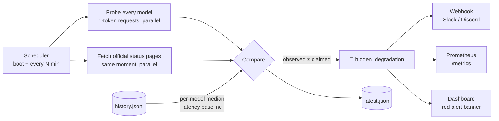

# 🩺 llm-health-monitor

> **Catch LLM outages the providers' status pages don't admit.**

[](https://github.com/hajunho/llm-health-monitor/actions)
[](LICENSE)


[](#contributing)

A tiny, zero-database health monitor for LLM APIs. It probes every model you configure —
across **OpenAI, Anthropic, Google Gemini, and xAI** — with the cheapest possible request
(1 output token), fetches each provider's **official status page at the same moment**, and turns
the gap between *what they claim* and *what you observe* into a first-class, queryable signal.

Everything is stored as **plain JSON files**. Clone, add your keys, run. That's the whole setup.

---

## Why does this exist?

**Official status pages are famously the last to know.** Real incidents routinely produce elevated
error rates and multi-x latency long before — or entirely without — the provider acknowledging
anything. Every existing tool falls on the wrong side of this problem:

- **Observability platforms** (Langfuse, OpenLLMetry, Opik) trace *your own* traffic — they can't
  tell you a provider is down before your users hit it, and they need a database + SDK integration.
- **Generic uptime tools** (Uptime Kuma, Gatus) can ping a URL, but you'd hand-write every
  provider's auth headers, request quirks, and body formats yourself — and they still can't say
  *"this is slow **for this model**"* or *"the vendor hasn't admitted this yet."*
- **LLM gateways** (LiteLLM) include health endpoints, but you must adopt the whole proxy.

This tool does one thing the others don't, in ~1,000 lines you can read in one sitting.

## The mechanism



Three ideas working together:

1. **Reality, not claims** — actual API probes from your own network, classified
   `ok / slow / error / unavailable` per model.
2. **Self-referential baselines** — each model is compared against **its own median latency**
   from history, not a global threshold. A model that normally answers in 800 ms suddenly taking
   3 s is degraded; a reasoning model that always takes 3 s is fine.
3. **The claim-vs-reality diff** — official Statuspage JSON is fetched *in the same instant* as
   the probes. When probes fail (for `confirmationRuns` consecutive runs, to ignore blips) or run
   ≥ `degradedLatencyRatio`× baseline **while the vendor still says "All Systems Operational"**,
   the model is flagged:

```json
// GET /api/health/insights
{
  "model_name": "gpt-5-mini",  "provider": "openai",
  "observed_status": "error",  "official_indicator": "none",
  "baseline_latency_ms": 850,  "latency_ratio": 3.4,
  "consecutive_failures": 2,   "hidden_degradation": true,
  "note": "Probe failed 2 time(s) in a row (error) while the official status page reports all operational."
}
```

That flag is what pages you before your users notice — and before the vendor tweets.

## Features

- 🕵️ **Hidden-degradation detection** — observed probes vs. official status pages, per-model latency baselines, blip-resistant confirmation
- ⏱ **Startup + scheduled checks** — one full probe when the server boots, then every N minutes
- 🪶 **Minimal-cost probes** — 1-token requests; image models via free metadata endpoints; typically well under $1/month per provider
- 📁 **JSON file storage** — `data/latest.json` + append-only `data/history.jsonl` (auto-trimmed). No database, ever
- 🌐 **Read-only HTTP API** + single-file **dark dashboard** with uptime % and red alert banners
- 🔔 **Webhook alerts** — one URL serves Slack (`text`), Discord (`content`), and machines (`events[]`); fires on transitions only, zero hourly noise
- 🏷 **Live README badge** (Shields.io endpoint) &nbsp;·&nbsp; 📈 **Prometheus `/metrics`** &nbsp;·&nbsp; 🐳 **Dockerfile**
- 🧩 **Pluggable providers** — one small interface; provider quirks (o-series `max_completion_tokens`, Gemini URL scheme, Anthropic version header) already handled
- 🚫 **Graceful key handling** — providers without an API key are `skipped`, never crash

## Quick start

```bash
git clone https://github.com/hajunho/llm-health-monitor.git
cd llm-health-monitor

cp config.example.json config.json      # 1. pick your models

export OPENAI_API_KEY=sk-...            # 2. only the keys you have
export ANTHROPIC_API_KEY=sk-ant-...
export GEMINI_API_KEY=...
export XAI_API_KEY=xai-...

./gradlew run                           # 3. done — dashboard on :8080
```

Open <http://localhost:8080>. The first check runs immediately.

<details>
<summary><b>Or with Docker</b></summary>

```bash
docker build -t llm-health-monitor .
docker run -p 8080:8080 \
  -v ./config.json:/app/config.json -v ./data:/app/data \
  -e OPENAI_API_KEY=sk-... -e ANTHROPIC_API_KEY=sk-ant-... \
  llm-health-monitor
```
</details>

## API

| Endpoint | Description |
|---|---|
| `GET /api/health/models` | Latest status of every configured model + official provider status |
| `GET /api/health/insights` | **Claim-vs-reality diff** — hidden degradation flags, baselines, streaks |
| `GET /api/health/uptime?runs=100` | Per-model uptime % + average latency over recent runs |
| `GET /api/health/history?limit=24` | Recent check runs, newest first |
| `GET /api/health/badge` | Shields.io endpoint-badge JSON |
| `GET /metrics` | Prometheus text exposition (incl. `llm_health_hidden_degradation`) |
| `POST /api/health/check` | Trigger an immediate re-check |

**Live badge for your README:**

```markdown

```

**Webhook alerts:** set `"webhookUrl"` to a Slack incoming webhook, Discord webhook, or any HTTP
endpoint. Notifications fire **only on transitions** (down / recovered).

## Configuration (`config.json`)

| Key | Default | Description |
|---|---|---|
| `port` | `8080` | HTTP port |
| `checkIntervalMinutes` | `60` | Minutes between checks |
| `slowThresholdMs` | `15000` | Latency above this → `slow` |
| `requestTimeoutMs` | `30000` | Per-probe timeout → `unavailable` |
| `dataDir` | `data` | Where JSON files are written |
| `historyMaxRuns` | `1000` | Max runs kept in `history.jsonl` |
| `webhookUrl` | `null` | Slack/Discord/generic webhook for down/recovery alerts |
| `uptimeWindowRuns` | `100` | Runs counted for uptime % and latency baselines |
| `degradedLatencyRatio` | `2.0` | Latency ≥ this × the model's median baseline → degradation |
| `confirmationRuns` | `1` | Consecutive failures required before flagging (raise to 2–3 to ignore blips) |
| `officialStatusUrls` | OpenAI + Anthropic | Statuspage JSON endpoints compared against observed probes |
| `models` | — | List of `{name, provider, type}` |

Supported providers: `openai`, `anthropic`, `google`, `xai` (alias `grok`).

## Status semantics

| Status | Meaning |
|---|---|
| `ok` | Responded within `slowThresholdMs` |
| `slow` | Responded, but slower than the threshold |
| `error` | Provider returned a non-OK response (bad model id, quota, auth…) |
| `unavailable` | Request timed out |
| `skipped` | No API key configured for this provider |

## Adding a provider

```kotlin
object MyProviderChecker : ProviderChecker {
    override val provider = "myprovider"
    override suspend fun check(client: HttpClient, model: ModelInfo, apiKey: String) {
        // smallest possible request; throw on failure
    }
}
```

Register it in `ProviderRegistry`, add a key branch in `ApiKeys`, and use
`"provider": "myprovider"` in `config.json`. If the provider runs an Atlassian Statuspage,
add its `/api/v2/status.json` URL to `officialStatusUrls` to get hidden-degradation detection too.

## Roadmap

- [ ] Response-content sanity probes (detect degraded *quality*, not just availability)
- [ ] Official status endpoints for Google / xAI (non-Statuspage formats)
- [ ] Regional probing (compare latency across regions)
- [ ] Historical hidden-degradation report ("incidents the vendor never acknowledged")

## Contributing

Issues and PRs welcome — especially new provider checkers and official-status adapters.
The whole codebase is small by design; please keep it that way.

## Notes

- API keys are read from **environment variables only** — never written to config or data files.
- The Gradle wrapper JAR is the official Gradle 8.5 artifact (SHA-256 verified), and the
  distribution download is checksum-pinned in `gradle-wrapper.properties`.
- `POST /api/health/check` is unauthenticated by design (self-hosted tool). Put it behind a
  reverse proxy or add auth if you expose it publicly.

Born from a production multi-LLM service (ZeliAI) where knowing *"which provider is down right
now?"* before users notice turned out to matter a lot.

## License

[MIT](LICENSE)
